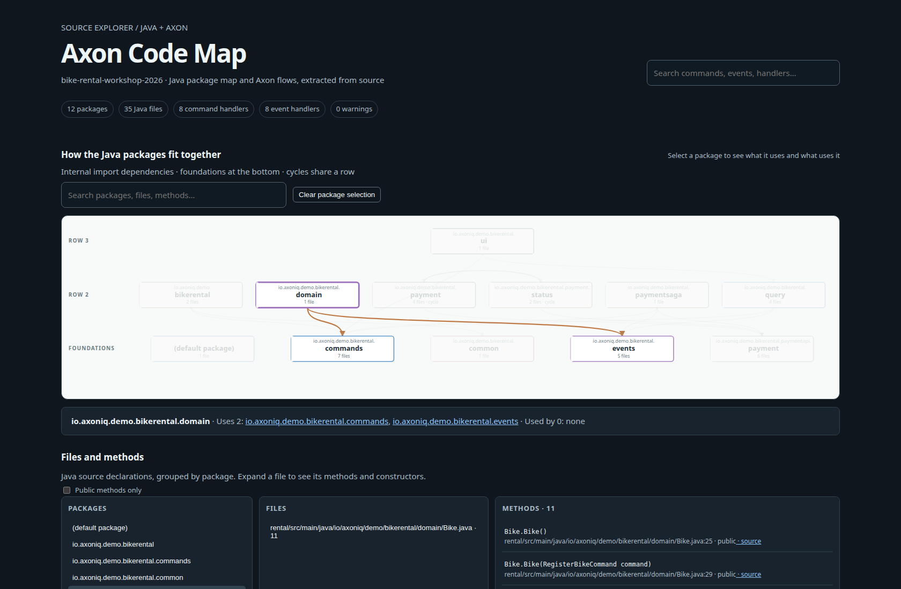
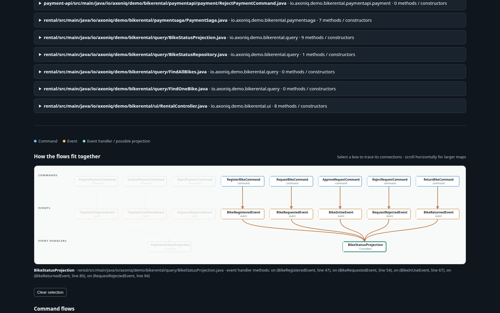

# Axon Code Map

Generate a standalone, searchable HTML map for **any Java project**: a layered package-dependency graph and an inventory of files, methods and constructors. For Axon applications, it also maps commands → events → event handlers. Inspired by [codemap](https://github.com/peterretief/codemap); this is an independent implementation, not a fork. Source stays on your machine and the resulting HTML needs no server, Java build, Java runtime, or external assets.

## Example: AxonIQ bike rental workshop

This map was generated from [AxonIQ/bike-rental-workshop-2026](https://github.com/AxonIQ/bike-rental-workshop-2026) at commit [`8d9fdd0`](https://github.com/AxonIQ/bike-rental-workshop-2026/tree/8d9fdd09b793cec619c0a40f9f9fc7ae138741fd). The scan found 12 packages, 35 Java files, 8 command handlers and 8 event handlers. For example, `RegisterBikeCommand` applies `BikeRegisteredEvent`, consumed by `BikeStatusProjection`.

Java package dependencies:



Axon message flows (events converge on the same projection box):



[Open the interactive workshop map on GitHub Pages](https://franclaw.github.io/axon-codemap/) or [download the standalone HTML](examples/bike-rental-workshop.html). To reproduce:

```sh
git clone https://github.com/AxonIQ/bike-rental-workshop-2026.git
git -C bike-rental-workshop-2026 checkout 8d9fdd09b793cec619c0a40f9f9fc7ae138741fd
axon-codemap --root bike-rental-workshop-2026 -o bike-rental-workshop.html
```

## Install and use

Requires Python 3.10+ and pip. From this repository:

```sh
python3 -m venv .venv
. .venv/bin/activate
pip install .
axon-codemap --root /path/to/java-project -o code-map.html
```

Open `code-map.html` in a browser. The Java package graph is always shown, including for projects without Axon. An arrow means a file in the source package imports a type or static member from the destination package. Select a package to see what it uses and what uses it, and drill down through its files to methods. Dependency names are clickable. Search packages, files and methods; method results search the whole project. Use the public-only filter to show methods declared public (including implicit public interface methods). Packages that use each other share a row and are marked as a cycle. Axon graphs appear when handlers are detected; select a node to trace connected flows. Event handlers belonging to the same class share one box, with multiple arrows into it. The detailed Axon list remains below the graph. Graphs scroll horizontally on narrow screens and support keyboard selection.

When the scanned directory is inside a Git checkout with a GitHub `origin`, method links point to the corresponding file and line at the checked-out commit. Uncommitted changes are not reflected in those links. Other projects remain fully usable without links.

`--include-tests` includes test directories; otherwise `test` and `tests` directories are omitted, along with common build and vendor directories. Multi-module trees are scanned recursively; identical Java package names across modules are combined.

To try the included example:

```sh
axon-codemap --root tests/fixtures -o example.html
```

## What it detects

- Java packages, files, method and constructor declarations, and imports between packages declared in the scanned sources. Explicit, static and wildcard imports are considered. Third-party packages are not displayed.
- Imports indicate a **possible dependency**, including potentially unused imports or a wildcard import for which no type is actually used. Fully qualified references without an import, build dependencies, runtime links and reflection are not traced.
- For Axon applications:

- Methods or constructors annotated `@CommandHandler`, using the first parameter as the command payload.
- Direct `apply(new Event(...))` and `AggregateLifecycle.apply(new Event(...))` inside a command handler, including conditional branches. Each apply is shown with its source line.
- Methods annotated `@EventHandler` as consumers. `@EventSourcingHandler` is deliberately excluded: it usually rebuilds aggregate state, not a projection. A regular event handler is a **possible** projection; Axon also uses these for other purposes.
- Simple type names are resolved using explicit imports, declarations in the same package, and unambiguous wildcard imports among scanned sources. Fully-qualified names are retained. Matching requires the same resolved name, not just a matching short name.

## Important limits

Both graphs are static source maps, not runtime execution traces. For Axon: a shown event might only be emitted conditionally, and consumer execution is not guaranteed. It does **not** follow helper methods, variables passed to `apply`, factory methods, returned events, inheritance, event gateways, sagas, custom/composed annotations, or runtime configuration. Unrecognized apply payloads and syntax errors are reported in the page. Unscanned external types, nested types, wildcard imports, annotation payload overrides, and unusual parameter ordering may not resolve correctly. Check source paths and line numbers when interpreting the map. Do not treat missing links as proof that a relationship cannot happen.

## Tests

```sh
python -m unittest discover -s tests -v
```
